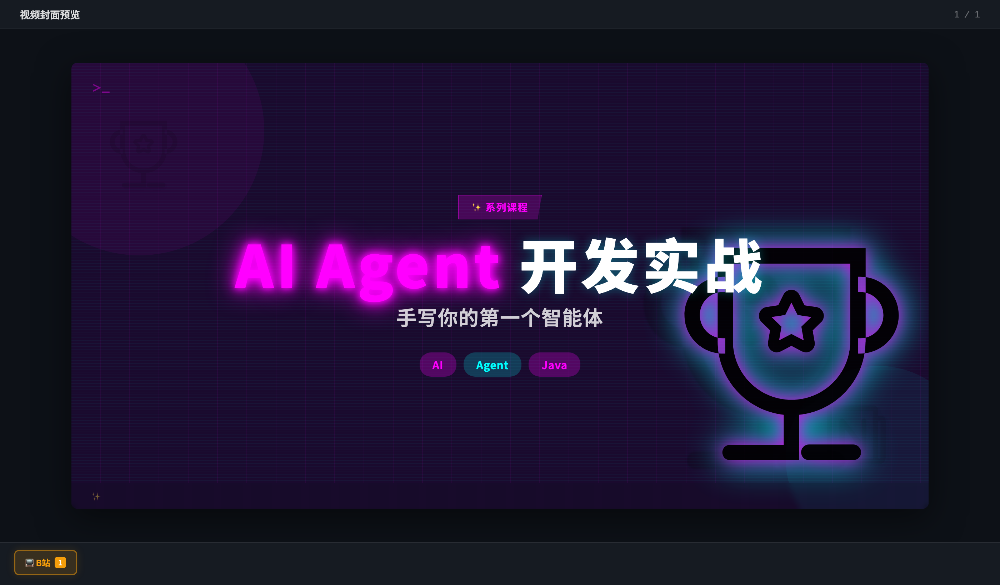
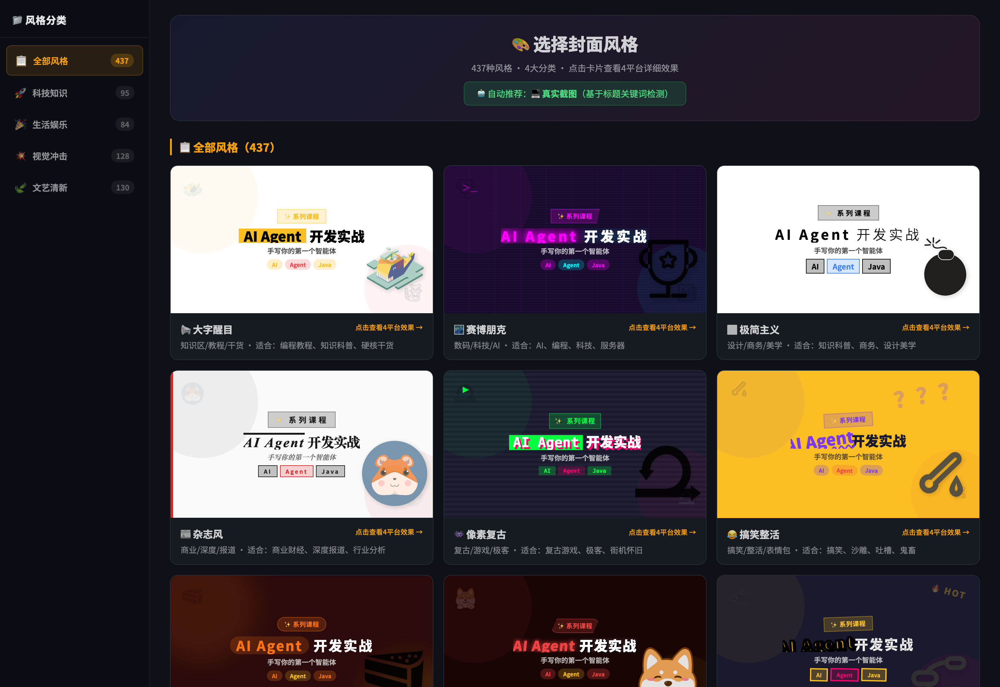
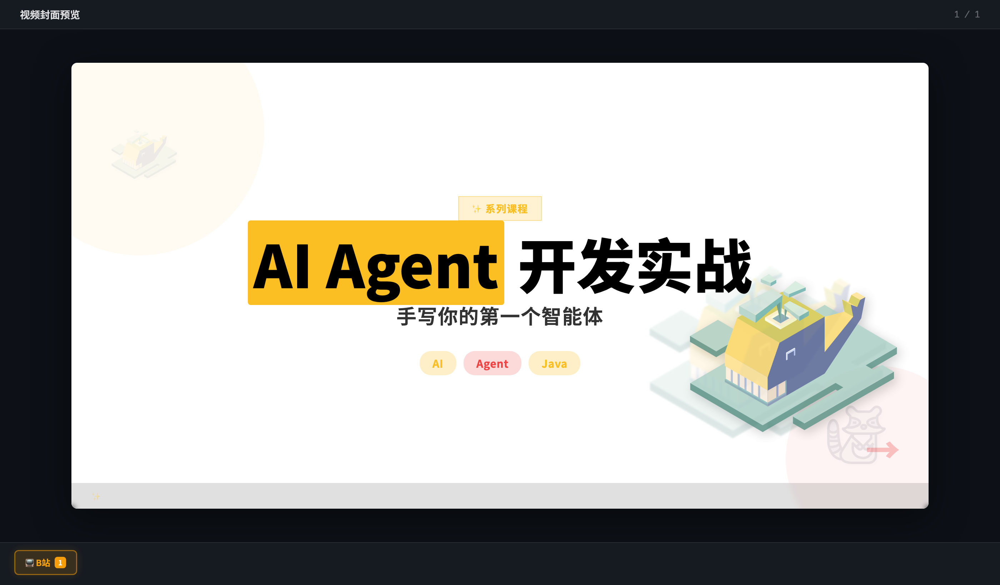
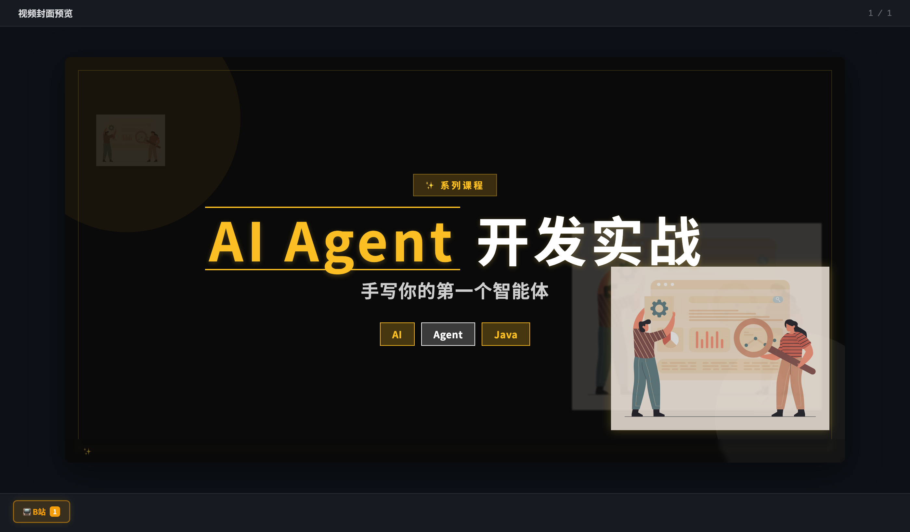
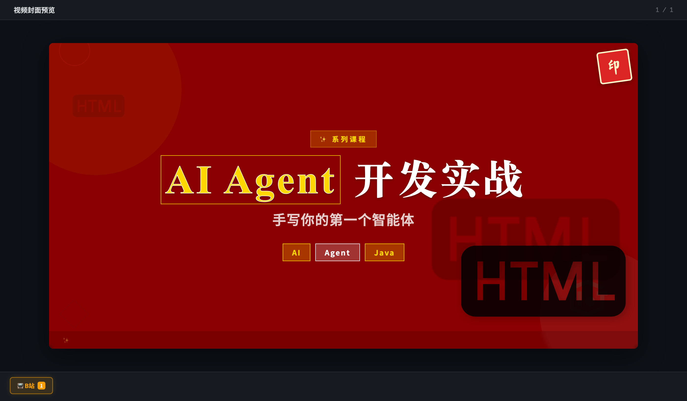
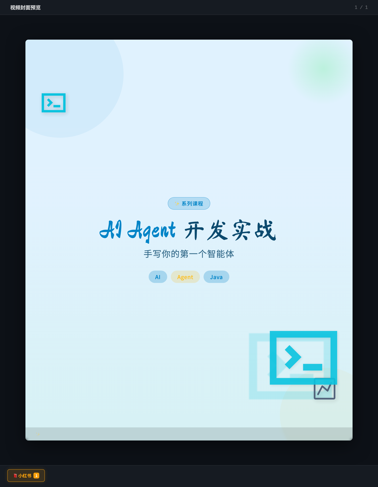
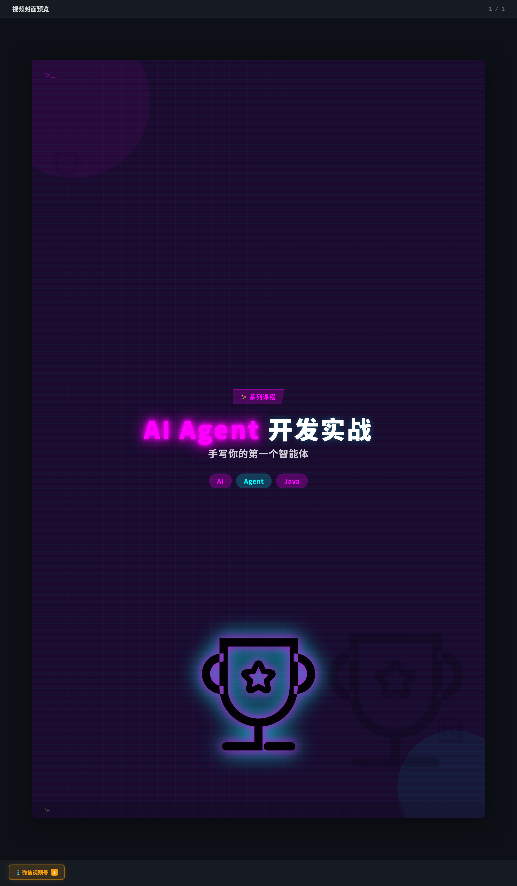
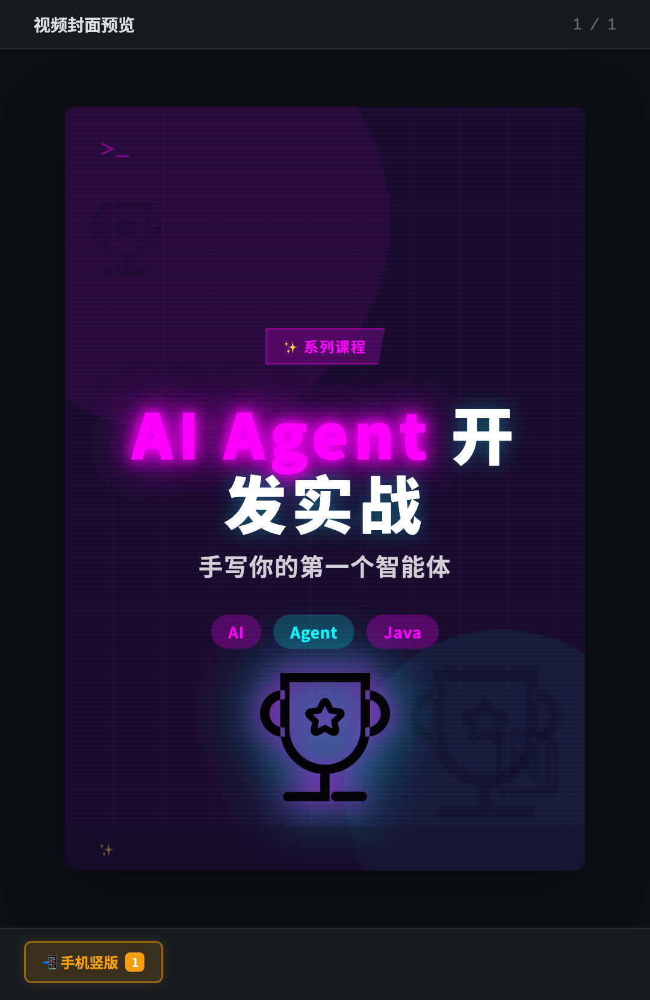

# xfg-skills-video-cover · 视频封面生成技能

> **给每一期视频，生成一张让人想点进来的封面。**

xfg-skills-video-cover 是一个视频封面生成引擎：输入课程标题或 PPT 文件，输出**大字体突出、俏皮、抓眼球**的爆款封面 HTML。专为 B站/小红书/微信视频号/手机竖版设计——437 种风格方案 × 231 套配色一键预览，多平台尺寸一键生成，单文件交付即拿即用。



一个封面生成器长这样：

- **437 种风格方案** — 55 种风格 × 多套配色，4 大分类全覆盖：🚀 科技知识 / 🎉 生活娱乐 / 💥 视觉冲击 / 🍃 文艺清新
- **主题选择器** — 一次生成全部风格的真实预览墙，点卡片即可对比挑选，告别"开盲盒"
- **4 平台尺寸** — B站 16:9 / 小红书 3:4 / 视频号 9:16 / 手机竖版，一键全出
- **大卡通角色（Mascot）** — 每张封面自动匹配 iconfont 卡通角色（232 个本地 SVG），封面有"主角"
- **爆款标题生成器** — 震惊体/利益体/悬念体/数字体等 8 种风格自动打分推荐
- **真人出镜** — `--photo-url` 传入照片，55 种风格各自做不同的边框/圆角/滤镜处理
- **单文件交付** — 图标全部内联 data URI，一个 HTML 双击即开，无外部依赖

而这一切对生成方只有一个约束：**一条命令出图，参数即设计。**给 AI Agent 用，也给你自己用。

---

## 你可以用它做出什么

| 场景 | 输入 | 产出 |
|---|---|---|
| **系列课程封面** | 课程标题 + 章节大纲 | 每节一张、风格统一的系列封面 |
| **从 PPT 提取** | 一份 HTML PPT | 自动提取章节，批量生成配套封面 |
| **多平台分发** | 一个标题 | B站/小红书/视频号/手机竖版 4 种尺寸一次出齐 |
| **标题优化** | 一个朴素的主题名 | 8 种爆款风格打分推荐，选中再出图 |

一句话：**凡是需要"3 秒内让人想点进来"的视频，都值得一张好封面**——B站教程、小红书笔记、视频号课程、播客竖版，都在射程内。

## 一个真实案例

以《AI Agent 开发实战》这门课为例，全部案例在 `case/` 下，浏览器直接打开：

**风格对比**（同一段文案，5 种风格）：

- `case/cover-cyber.html` — 🌃 赛博朋克，霓虹发光 + 奖杯 Mascot
- `case/cover-bold.html` — 📢 大字醒目，知识干货首选
- `case/cover-luxury.html` — 👑 黑金奢华，评测/开箱
- `case/cover-guochao.html` — 🏮 国潮风，文化/传统主题
- `case/cover-fresh-xhs.html` — 🍃 清新治愈，小红书 3:4 竖版

**多平台尺寸**（同一主题，赛博朋克风格）：

- `case/cover-cyber-wechat.html` — 视频号 9:16（1080×1920）
- `case/cover-cyber-mobile.html` — 手机竖版（440×710）

实拍截图（真实渲染效果）：

**① 主题选择器** —— 437 种风格一次铺开：左侧分类过滤（科技知识/生活娱乐/视觉冲击/文艺清新），右侧每张卡片都是**当前标题的真实渲染效果**，选中风格点击即可看 4 平台详情：



**② 赛博朋克 · B站 16:9** —— 霓虹高亮词 + 发光奖杯 Mascot + 半透明标签胶囊，底部信息栏标注平台与标题，直接可上传：


**③ 大字醒目 · B站 16:9** —— 高饱和色块 + 超大号标题 + 高亮词倾斜强调，信息密度低、冲击力强，适合知识区：



**④ 黑金奢华 · B站 16:9** —— 深黑底 + 金色衬线 + 烫金质感边框，评测开箱类内容的"贵气"路线：



**⑤ 国潮风 · B站 16:9** —— 传统纹样 + 朱红金配色 + 国风 Mascot，文化/历史/传统主题首选：



**⑥ 多平台适配** —— 同一主题自动重排：小红书 3:4、视频号 9:16、手机竖版，字号/间距/徽章逐平台调优，不是简单缩放：

<p>
  
  
  
</p>

同一份文案、不同风格——差别只在参数。这正是本技能的设计：**引擎固定，风格靠参数表达。**

## 快速开始

```bash
# 1. 体验成品：浏览器打开任意案例
open case/cover-cyber.html

# 2. 生成爆款标题建议（8 种风格自动打分）
python3 scripts/title_generator.py --title "AI Agent 开发实战" --tags "AI,Agent,Java"

# 3. 生成 437 种风格选择墙，挑选喜欢的风格
python3 scripts/theme_picker.py \
  --title "AI Agent 开发实战" \
  --subtitle "手写你的第一个智能体" \
  --tags "AI,Agent,Java" \
  --badge "系列课程" \
  --highlight "AI Agent" \
  --output theme-picker.html

# 4. 按选定风格出图（单平台 / 全平台）
python3 scripts/generate_covers.py \
  --output covers.html \
  --title "AI Agent 开发实战" \
  --subtitle "手写你的第一个智能体" \
  --tags "AI,Agent,Java" --badge "系列课程" \
  --highlight "AI Agent" \
  --theme cyber --platform all

# 5. 安装为 Agent 技能（对话式生成）
cp -r xfg-skills-video-cover ~/.workbuddy/skills/    # WorkBuddy
cp -r xfg-skills-video-cover ~/.claude/skills/       # Claude Code
```

安装后在对话里直接说：

- 「给这期视频做个 B站封面，主题是 Docker 部署实战」
- 「从这份 PPT 提取章节，批量生成系列课程封面」
- 「这个标题太朴素了，帮我优化成爆款标题」
- 「生成小红书和视频号两个尺寸的封面」

## 生成管线（它如何工作）

```
标题优化 → 风格选择 → 封面生成 → 多平台适配 → 单文件交付
   │           │           │            │
title_      theme_      generate_    同一主题按平台
generator   picker      covers.py    重排字号与布局
8风格打分   437方案预览  55风格×231配色  4 尺寸一键出
```

- **脚本分工**：`title_generator.py` 优化标题 → `theme_picker.py` 出风格选择墙 → `generate_covers.py` 按最终风格出图 → `extract_chapters.py` 从 PPT 提取章节批量生成。
- **图标内联**：iconfont SVG 以 data URI 内嵌，交付文件零外部依赖；`--auto-icons` 还可按标题关键词从 iconfont.cn 自动检索新图标。
- **照片处理**：5 种照片预设（硬核揭秘/科技工具/情绪冲击/游戏猎奇/知识干货），按风格自动应用边框、圆角与滤镜。

## 多平台尺寸规格

| 平台 | 比例 | 尺寸 | 标题字号 |
|------|------|------|----------|
| B站 | 16:9 | 1200×675 | 82px |
| 小红书 | 3:4 | 900×1200 | 64px |
| 视频号 | 9:16 | 1080×1920 | 56px |
| 手机竖版 | ~9:14.5 | 440×710 | 52px |

`--platform all` 一次生成全部 4 种尺寸，各平台字号、间距、徽章独立调优。

## 目录结构

```
xfg-skills-video-cover/
├── SKILL.md                          # 技能入口：风格分类、工作流、参数速查
├── assets/
│   ├── cover-template.html           # 单封面渲染引擎
│   ├── full-page-template.html       # 多封面汇总页模板
│   └── iconfont/                     # 232 个本地卡通 SVG（5 大分类）
├── references/
│   ├── color-schemes.md              # 231 套配色方案速查
│   ├── design-spec.md                # 设计规范
│   └── emoji-library.md              # emoji 装饰库
├── scripts/
│   ├── generate_covers.py            # 主生成脚本（PPT提取/单页/批量/多平台/真人照片）
│   ├── theme_picker.py               # 437 种风格选择墙
│   ├── title_generator.py            # 爆款标题生成器（8 风格打分）
│   ├── extract_chapters.py           # PPT 章节提取
│   └── download_icons.py             # iconfont 图标下载器
└── case/                             # 真实案例，浏览器直接打开
    ├── cover-cyber.html              #   赛博朋克 · B站
    ├── cover-bold.html               #   大字醒目 · B站
    ├── cover-luxury.html             #   黑金奢华 · B站
    ├── cover-guochao.html            #   国潮风 · B站
    ├── cover-fresh-xhs.html          #   清新治愈 · 小红书
    ├── cover-cyber-wechat.html       #   赛博朋克 · 视频号 9:16
    ├── cover-cyber-mobile.html       #   赛博朋克 · 手机竖版
    └── screenshots/                  #   案例实拍截图（README 引用）
```

## License

Apache-2.0
